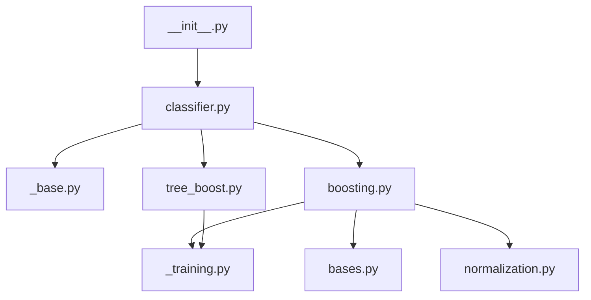

# SSTGAM code map

A function/class-level map of `src/sstgam/`, cross-linked by call relationships.
Each `.md` file below documents exactly one function or method: its purpose, a
line-by-line walkthrough, what it calls, and what calls it. Start anywhere and
follow the **Calls** / **Called by** links like graph edges.

See also: [README.md](../../README.md) (usage), [ARCHITECTURE.md](../../ARCHITECTURE.md) (model design).

## Module dependency graph

`_base.py`, `bases.py`, `normalization.py`, and `_training.py` have no
dependencies on the rest of the package — they're the leaves. `classifier.py`
is the only file that imports both backends.

## Modules

| Module | What it does | Index |
| --- | --- | --- |
| `__init__.py` | Public re-export of `SSTGAM` | [package_init/index.md](package_init/index.md) |
| `classifier.py` | Public `SSTGAM` class; picks a backend | [classifier/index.md](classifier/index.md) |
| `_base.py` | sklearn interface; wide-table → tensor parsing | [sklearn_base/index.md](sklearn_base/index.md) |
| `boosting.py` | Spline backend (`method="spline"`) | [boosting/index.md](boosting/index.md) |
| `tree_boost.py` | Tree backend (`method="tree"`) | [tree_boost/index.md](tree_boost/index.md) |
| `bases.py` | RBF basis + roughness-penalty primitives | [bases/index.md](bases/index.md) |
| `normalization.py` | Value/static normalization helpers | [normalization/index.md](normalization/index.md) |
| `_training.py` | Validation split + loss shared by both backends | [training/index.md](training/index.md) |

## Suggested entry points

- **Trace a `fit()` call end to end:** [sklearn_base/fit.md](sklearn_base/fit.md) →
  [classifier/fit_trainer.md](classifier/fit_trainer.md) →
  [boosting/fit.md](boosting/fit.md) or [tree_boost/fit.md](tree_boost/fit.md) →
  `_fit_one_bag` in either module.
- **Trace a `predict_proba()` call:** [sklearn_base/predict_proba.md](sklearn_base/predict_proba.md) →
  [sklearn_base/positive_probability.md](sklearn_base/positive_probability.md) →
  backend `predict_proba`.
- **The core "cyclic Newton boosting" mechanic:** [boosting/update_block.md](boosting/update_block.md)
  (spline) or [tree_boost/fit_one_bag.md](tree_boost/fit_one_bag.md) (tree).
- **The adaptive split-order logic from ARCHITECTURE.md:** [tree_boost/adaptive_tree_update.md](tree_boost/adaptive_tree_update.md).
